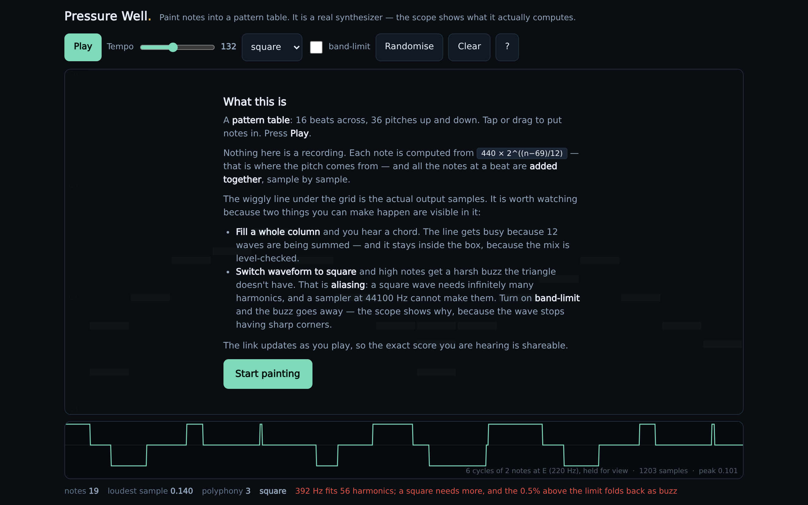
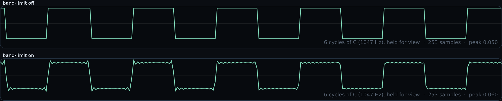

# Pressure Well

<!-- Front page image: docs/shot-onboarding.png -->

A pattern table you paint with your finger, that turns out to be a real synthesizer — and an oscilloscope underneath showing what it actually computed.

**▶ [Play it now](https://raw.githack.com/thaumapolis/pressure-well/main/index.html)** — no install, no network, nothing to build.

*About that link: it is served by [raw.githack.com](https://raw.githack.com), which fetches the committed `index.html` from this repo on GitHub. It needs the network to *load*; once loaded the page asks for nothing else. Opening [`index.html`](index.html) from disk behaves identically and needs no network at all.*



**The one claim worth checking:** switch on **band-limit** and look at the scope. The corners get *worse*, not better. That is the whole point.



A square wave is a step, and a step needs infinitely many sine harmonics. A sampler at 44100 Hz can only make the ones below 22050 Hz. A C6 at 1047 Hz fits **21** of them. The harmonics above the limit do not quietly vanish — they fold back down into the audible band at frequencies unrelated to the note, and that is the buzz. Band-limiting builds the wave from only the harmonics that fit, which is why the plateau gets a ripple on it (Gibbs, the unavoidable cost of a finite series at a jump) and why the buzz goes away.

The scope is not an illustration of that. It draws the same samples that go to your speakers.

## Controls

| Control | What it does |
| --- | --- |
| **Drag on the grid** | Paint notes. 16 beats across, C3 to C6 up and down. Drag over a note to erase it. |
| **Play** / `Space` | Play the loop. The amber line is the playhead. |
| **Tempo** | 50–240 bpm. Only changes timing, never pitch. |
| **waveform** | square, saw, triangle. |
| **band-limit** | Build each note from only the harmonics that fit under Nyquist. This is the switch to play with. |
| **Randomise** | A random score inside one pentatonic set, so it is still listenable. |
| **Clear** | Empty the table. It stays empty on reload. |
| `?` | Re-open this explanation. |

The URL carries the score, so the exact thing you are hearing is a link.

## What to look for

Three things, in order of how satisfying they are:

1. **Triangle first, then square.** A triangle's harmonics die off as 1/k², so by C6 it has already used nearly everything that fits — there is barely anything left to fold back. A square's die off as 1/k, so it has a lot left. Same note, same loudness; only the shape differs.
2. **Go up the keyboard** and turn on band-limit. The lower notes barely change. The top octaves change completely, because that is where fewer harmonics fit.
3. **Fill a whole column** — 12 notes at once — and watch `loudest sample`. It stays under 1.0, because the mixer is level-checked against that worst case rather than guessed.

The readout under the scope states the specific numbers for the score you are looking at: how many harmonics fit, and what fraction of the waveform's energy lies above the limit. A triangle says so at roughly 0.002%; a square at C6 says 2%.

## Honest limits

- **The preview note is held longer than you hear it.** The scope shows 6 cycles of the first score event, but a note is one beat — at 132 bpm that is 4.5 ms, too short to inspect. The caption says "held for view". Every sample drawn is still a sample the synthesizer produced for these notes at these settings; the shape is under inspection, not the duration.
- **The scope's vertical scale is set by the window's own peak**, so the trace fills the panel. The peak is printed next to it. It is an oscilloscope's volts-per-division, not the signal's level.
- **The range stops at C6**, where 21 harmonics fit. Aliasing gets worse above that, but this grid is sized for a finger.
- **No reverb, no filters, no effects.** Deliberately: an effect chain would give the buzz somewhere to hide.
- **Audio needs a click.** Browsers refuse to start sound before a gesture, so nothing plays until you press Play.

## Running it

`index.html` is the file to open — one file, no network, nothing to install. It opens from disk, from a static server, or from a sandboxed preview pane.

```sh
python3 -m http.server -d . 8000   # then open http://localhost:8000/
```

### Building and checking

The source lives in `src/`; `index.html` is generated from it and is not hand-written. Everything below runs in the pinned Nix dev shell, which supplies Node, esbuild, jsdom, Playwright and Chromium.

```sh
nix develop --command node tools/build.mjs     # regenerate index.html from src/
nix develop --command bash tools/check.sh      # syntax, page freshness, 36 unit/behaviour checks
nix develop --command bash tools/check.sh --browser   # + headless Chromium, goldens, screenshots
nix flake check                                # the browser-free half, in the Nix build
```

`tools/check.sh` also compares the committed `index.html` against a fresh build of `src/`, so a stale generated page fails rather than serving someone else's code.

Screenshots go to `.tmp/shots`. Goldens live in `tests/golden/` and are compared per pixel (2/255 per channel, under 0.2% of pixels, changed region reported). To re-record: `UPDATE_GOLDEN=1 nix develop --command bash tools/check.sh --browser` — then **look at them** before committing. A golden test with no baselines aborts rather than passing.

### What the checks cover

| Layer | Covers | Needs |
| --- | --- | --- |
| `tests/synth.test.mjs` | tuning, envelope, mixing, and that band-limiting does what is claimed | Node |
| `tests/score.test.mjs` | the grid, editing, URL round-trip, range edges | Node |
| `tests/app.test.mjs` | the generated page boots; controls are wired to state, not just present | jsdom |
| `tools/browser-check.mjs` | rendering, layout at three viewports, touch targets, playback reaching Web Audio, goldens | Chromium |

The audio claims are checked numerically, not by ear. Two of them are load-bearing and easy to get wrong, so they are pinned: **band-limiting is loudness-matched**, so the switch compares timbre rather than volume; and **triangle is unaffected**, which is what proves the difference in square and saw is the mechanism rather than an accident of the renderer.

## How the mechanism is built

`src/synth.js` — three waveforms, each in two versions:

- **Naive:** `phase < 0.5 ? 1 : -1`. The arithmetic you would write first.
- **Band-limited:** the Fourier series truncated below Nyquist, from the same coefficient table (`PARTIAL`), renormalised on RMS so loudness matches.

`aliasedEnergyFraction` is Parseval over that same table, so the sentence in the readout cannot disagree with what is synthesized — there is no second measurement to drift.

Two things worth knowing if you poke at it:

- **An additive sine sum does not alias.** It is band-limited by construction. Only sampling a *discontinuous function* aliases. Any claim of the form "I measured aliasing with an FFT" has to say which of those two it measured — this project measured the wrong one twice before getting it right.
- **The Fourier signs were fitted, not remembered.** A positive 1/k sine series is the *mirror* of a saw, not a saw, and the triangle on this grid is an all-cosine positive series, not the textbook alternating-sine form. Both errors pass a glance and both are now pinned by a test that measures the series against the closed form.
